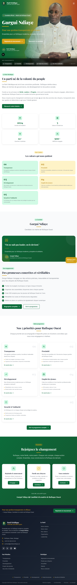
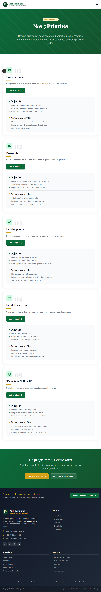
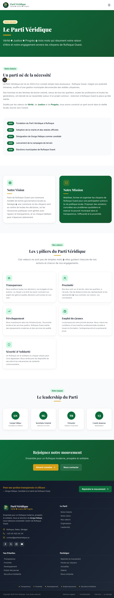
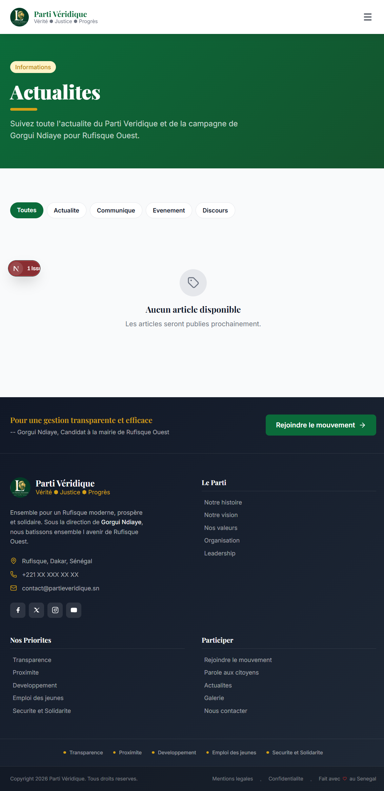

# Parti Véridique — Site de campagne

Site vitrine du Parti Véridique et de la campagne de **Gorgui Ndiaye**, candidat à la mairie de Rufisque Ouest. Construit avec Next.js (App Router), Tailwind CSS et Supabase.

## Aperçu du site

### Page d'accueil



### Nos 5 priorités



### Le Parti



### Actualités



## Pages

- **Accueil** — présentation du parti, du candidat et du programme
- **Nos 5 priorités** — programmes détaillés (`/priorites`)
- **Le Parti** — histoire, vision, mission, valeurs et leadership
- **Actualités** — articles gérés depuis l'espace admin
- **Le Candidat**, **Galerie**, **Contact**, **Rejoindre** le mouvement

## Espace admin

Une back-office est disponible sur `/admin` (login protégé) pour gérer les actualités, les contributions, les messages et les sympathisants via Supabase.

## Stack

- [Next.js](https://nextjs.org) (App Router) + React
- Tailwind CSS
- [Supabase](https://supabase.com) (données + auth)

## Démarrage

```bash
npm install
npm run dev
```

Ouvrir [http://localhost:3000](http://localhost:3000).

Configurer un `.env.local` avec les variables Supabase avant de lancer le serveur.
